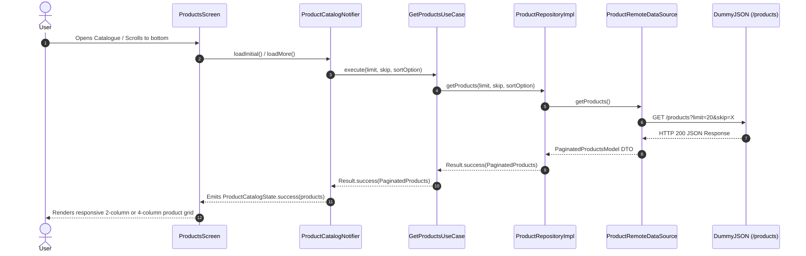

# ShopSphere

A production-grade, responsive e-commerce catalogue application built with **Flutter** and **Feature-First Clean Architecture**, integrating seamlessly with the [DummyJSON](https://dummyjson.com/) REST API. Developed for the **Prosessed Flutter Developer Intern** assignment (Submitted: 21 October 2026).

---

## 📸 Screenshots & Visual Demonstration

> **Note**: To view captured screenshots or add your own, place the PNG files in the `screenshots/` directory as structured below:

| Mobile Catalogue (Phone) | Product Details (Phone) | Shopping Cart (Phone) | Order Confirmation (Phone) |
| :---: | :---: | :---: | :---: |
|  |  |  |  |

| Tablet / Landscape Master-Detail Catalogue | Tablet / Landscape Product Details |
| :---: | :---: |
|  |  |

*If capturing new device screenshots prior to final submission:*
1. **Phone - Catalogue**: 2-column grid with category chips and search bar.
2. **Phone - Product Details**: Image carousel, star rating, bound-enforced quantity selector, and Add to Cart button.
3. **Phone - Cart Screen**: Persisted item list with increment/decrement/remove and price breakdown card.
4. **Phone - Order Confirmation**: Order ID badge, item breakdown, and return CTA after simulated checkout.
5. **Tablet - Catalogue**: 3-to-4 column grid with persistent `NavigationRail`.
6. **Tablet/Landscape - Details**: Side-by-side split (carousel on the left, details & reviews on the right).

---

## ✅ Implemented Features

### Mandatory Features
- [x] **Authentication & Session Persistence**:
  - Secure login via `POST /auth/login` using test credentials.
  - JWT tokens securely persisted using `flutter_secure_storage`.
  - Automatic session restoration on launch via `GET /auth/me`.
  - Token refresh handling on HTTP 401 with graceful logout on expiration.
  - Reactive routing via `GoRouter` redirecting unauthenticated users to `/login`.
- [x] **Product Catalogue**:
  - Paginated infinite scroll via `GET /products?limit=20&skip=X` with shimmer skeleton loading.
  - Instant debounced search (400ms debounce) via `GET /products/search?q=...`.
  - Category filtering (`GET /products/categories` and `GET /products/category/:slug`).
  - In-memory client-side sorting (Price Low-to-High, Price High-to-Low, Rating, Alphabetical).
  - Pull-to-refresh on catalogue grid.
- [x] **Product Details & Stock Controls**:
  - Detailed product view at `/products/:id` with swipeable multi-image carousel.
  - Out-of-stock badge disabling "Add to Cart" when `stock <= 0`.
  - Quantity selector strictly bounded to `[1, availableStock]`.
  - Customer reviews with reviewer initials, 5-star ratings, and formatted dates.
  - Dedicated 404 "Product Not Found" screen for invalid IDs (e.g., ID `9999`).
- [x] **Shopping Cart & Local Persistence**:
  - Add to cart with quantity controls (merges duplicate additions of the same product).
  - Quantity increment/decrement bounded by available product stock and minimum of 1.
  - Item removal with swipe or delete icon, and clear-cart confirmation dialog.
  - Complete local persistence via `shared_preferences` — automatically restored on app restart.
  - Dynamic cart badge on App Bar action and bottom navigation tab.
- [x] **Totals & Pricing Breakdown**:
  - Subtotal (original catalog price sum before discounts).
  - Promotional discount savings accurately calculated without double-discounting.
  - Grand total payable amount.
- [x] **Order Checkout Simulation**:
  - Simulates order creation via `POST /carts/add` using active user ID and product payload.
  - Active loading indicator and concurrent request prevention.
  - On failure: Retains cart contents and surfaces retryable SnackBar.
  - On success: Automatically empties cart and navigates to Order Confirmation screen.
- [x] **Responsive Layouts**:
  - Compact (Phone < 600px): 2-column grid with `NavigationBar` (bottom nav).
  - Medium (Tablet 600px - 840px): 3-column grid with `NavigationRail`.
  - Expanded (Desktop/Wide > 840px): 4-column grid and side-by-side product details.
  - Strict overflow protection ensuring stability at **1.3x system text scaling**.
- [x] **Profile & Secure Logout**:
  - Displays user profile, avatar, email, and session information.
  - Confirmation dialog on sign out, revoking tokens and returning to `/login`.

### Bonus / Advanced Features
- [x] Glassmorphism & polished Material 3 design tokens with customized color scheme.
- [x] Token refresh flow on 401 Unauthorized responses.
- [x] Complete shimmer loading skeletons for catalogue cards and product details.
- [x] Offline fallback and network error handling with retry triggers.

---

## 🛠️ Environment & Key Dependencies

- **Flutter Version**: `3.41.4` (Channel stable)
- **Dart SDK**: `^3.11.1`
- **Target Platforms**: Android (minSdkVersion: 21, targetSdkVersion: 34), iOS, Web, Windows

| Dependency | Version | Purpose |
| :--- | :--- | :--- |
| `flutter_riverpod` | `^3.3.2` | Compile-time safe, declarative state management without BuildContext dependency |
| `dio` | `^5.11.1` | Network client with connection/receive timeouts (15s) and interceptors |
| `go_router` | `^17.5.0` | Declarative routing with reactive authentication redirection |
| `get_it` | `^9.3.0` | Service locator for singletons (`ApiClient`, `Storage`, Repositories) |
| `equatable` | `^3.0.0` | Value equality for entities, domain models, and failure states |
| `flutter_secure_storage` | `^11.2.0` | Hardware-backed encrypted storage for sensitive JWT tokens |
| `shared_preferences` | `^2.5.6` | Asynchronous key-value local storage for shopping cart persistence |
| `cached_network_image` | `^3.4.1` | Memory and disk image caching with placeholder shimmer effects |
| `mocktail` | `^1.0.5` | Type-safe mocking for unit and widget testing without code generation |

---

## 🏛️ Architecture & Folder Structure

The project implements **Feature-First Clean Architecture**, ensuring strict separation of concerns, testability, and independence from external frameworks:

```
lib/
├── core/
│   ├── di/               # GetIt service locator dependency registration
│   ├── error/            # Domain Failures & Data Layer Exceptions
│   ├── network/          # ApiClient, ApiEndpoints, Dio interceptors
│   ├── router/           # GoRouter configuration & route guards
│   ├── theme/            # Centralized Material 3 palette, typography & styles
│   ├── utils/            # AppConstants, Result<T> monad
│   └── widgets/          # AppShell, ErrorView, EmptyView
└── features/
    ├── auth/             # Login, token storage, session validation
    │   ├── data/         # Models (UserModel), remote/local data sources, repository impl
    │   ├── domain/       # Entities (User), repository interfaces, use cases
    │   └── presentation/ # AuthNotifier, AuthState, LoginScreen
    ├── products/         # Catalogue, search, category filter, details
    │   ├── data/         # ProductModel, CategoryModel, PaginatedProductsModel
    │   ├── domain/       # Product, Category, SortOption, UseCases
    │   └── presentation/ # CatalogNotifier, DetailsNotifier, Screens & Widgets
    ├── cart/             # Shopping cart, persistence, checkout simulation
    │   ├── data/         # CartItemModel, CheckoutOrderModel, Local/Remote sources
    │   ├── domain/       # CartItem, CartTotals, CheckoutOrder, UseCases
    │   └── presentation/ # CartNotifier, CheckoutNotifier, CartScreen, OrderConfirmation
    └── profile/          # User profile view, session details, logout
        ├── data/         # Profile remote source & repository bindings
        ├── domain/       # Profile use cases
        └── presentation/ # ProfileNotifier, ProfileScreen, LogoutDialog
```

### Data Flow Example (Product Catalogue Fetch)


---

## ⚡ Riverpod State Management & Trade-Offs

### Why Riverpod?
1. **Compile-Time Safety & No BuildContext Dependency**: Business logic and notifiers (`CartNotifier`, `AuthNotifier`) can execute asynchronously and interact with use cases without requiring a widget tree `BuildContext`.
2. **Selective Widget Rebuilding**: Using `ref.watch(provider.select((s) => s.totalQuantity))` ensures only relevant sub-widgets (e.g., the Cart badge) rebuild when specific properties change, preserving UI performance.
3. **Declarative Testing**: With `ProviderScope(overrides: [...])`, dependencies and state notifiers can be effortlessly mocked in unit and widget tests without altering production source code.

### Trade-Offs Considered
- *vs. BLoC*: Riverpod eliminates boilerplate events, states, and streams, resulting in cleaner, concise notifiers while maintaining predictable unidirectional data flow.
- *vs. Provider*: Riverpod avoids `ProviderNotFoundException` runtime errors, supports multiple providers of the same type, and provides first-class async state handling.
- *Learning Curve*: Requires understanding the separation between `NotifierProvider` and manual controller lifecycles.

---

## 🛡️ Error Handling & Resiliency

All application errors are captured, typed, and surfaced as accessible, actionable feedback:

- **HTTP 500 / Server Error** (`GET /http/500`): Captured by `ApiClient`, mapped to `ServerException` then `ServerFailure`. UI displays an `ErrorView` with an explicit **"Retry"** button.
- **HTTP 404 / Non-Existent Product** (`GET /products/9999`): Handled specifically by `ProductRemoteDataSourceImpl` throwing `NotFoundException`, mapped to `NotFoundFailure`. The details screen renders a dedicated **"Product Not Found"** view with a "Back to Catalogue" CTA.
- **Slow Network / Latency** (`GET /products?delay=3000`): Network timeouts configured at 15 seconds. Active shimmer skeleton views prevent UI jumping while data loads.
- **Offline / Airplane Mode**: Connection timeouts and socket failures map to `NetworkFailure` displaying a persistent alert: *"No internet connection. Please check your network and retry."*
- **Expired Session (HTTP 401)**: `AuthRepositoryImpl` intercepts 401s, attempts a token refresh via `/auth/refresh`, and if invalid, safely clears local credentials and triggers reactive redirection to `/login`.
- **Cart Persistence Resilience**: If local storage encounters corrupted or malformed JSON, `CartLocalDataSourceImpl` gracefully catches the exception, clears the corrupt key, and returns an empty cart instead of crashing.

---

## 🚀 Setup & Execution Guide

### Prerequisites
- Flutter SDK `3.41.4` (or compatible 3.x stable)
- Dart SDK `^3.11.1`
- Android SDK 34 (for Android builds)

### 1. Clone & Install Dependencies
```bash
git clone https://github.com/monukr26/prosessed-flutter-assignment.git
cd prosessed-flutter-assignment
flutter pub get
```

### 2. Run Debug Application
```bash
# Run on connected device or emulator
flutter run

# Or run specifically on Chrome / Windows desktop
flutter run -d chrome
flutter run -d windows
```

### 3. Build Release APK
```bash
flutter build apk --release
```
The output APK is generated at:
```
build/app/outputs/flutter-apk/app-release.apk
```

To rename for submission:
```bash
# Windows PowerShell
Move-Item -Path "build\app\outputs\flutter-apk\app-release.apk" -Destination "build\app\outputs\flutter-apk\ShopSphere_MonuKumar_v1.0.0.apk"
```

---

## 🧪 Testing & Verification

The project includes unit, repository, use-case, and widget tests covering all critical paths:

```bash
# 1. Format check
dart format --output=none --set-exit-if-changed lib test

# 2. Static analysis (0 issues required)
flutter analyze

# 3. Complete test suite
flutter test
```

### Test Results Summary
- **Analyzer Status**: `0 issues found` (clean static analysis).
- **Unit / Widget Tests**: **135 passing tests** (0 failed, 0 skipped).
- **Key Test Areas Covered**:
  - `ApiClient`: BaseUrl, timeouts, authorization header updates.
  - `Auth`: Session checking, login with credentials, invalid credentials, secure logout.
  - `Products`: Pagination skip/limit calculations, category selection, client-side sorting, debounce search.
  - `Product Details`: 404 handling, out-of-stock boundary clamps, reviews parsing, quantity selector bounds.
  - `Cart`: Duplicate item merging, stock limit enforcement, decrement bounds, subtotal and discount calculations, persistence round-tripping.
  - `Checkout`: Request formatting, loading state lock, cart clearance on success, retry on failure.
  - `Navigation & Shell`: Responsive NavigationRail vs. Bottom Navigation, live cart badge reactive counter.

---

## 🔑 Test Credentials

The application connects to DummyJSON's authentication service. Use the following credentials to log in:

- **Username**: `emilys`
- **Password**: `emilyspass`

*(Additional DummyJSON test credentials such as `michaelw` / `michaelwpass` are also supported by the API).*

---

## ⚖️ Assumptions & Trade-Offs

1. **DummyJSON Simulated Checkout**: DummyJSON is a public mock API. Orders submitted via `POST /carts/add` generate a mock order response with an allocated ID, but are not persisted into a live production database.
2. **Local Cart Storage**: Shopping cart state is stored locally in `SharedPreferences` as serialized JSON for immediate persistence across app restarts. In an enterprise system with multiple devices, cart state would sync with a remote cart service.
3. **Image Fallbacks**: DummyJSON provides varying image lists across product entries; the app prioritizes the high-resolution images array and seamlessly falls back to the product thumbnail if images are empty or fail to load.
4. **Text Scaling Safeguard**: UI components specify responsive constraints and `Wrap` widgets to maintain visual integrity up to **1.3x system font scaling**.

---

## 👨‍💻 Author & AI Disclosure

- **Candidate**: Monu Kumar ([@monukr26](https://github.com/monukr26))
- **Submission Date**: 21 October 2026
- **Position**: Flutter Developer Intern — Prosessed

### AI Tool Usage Disclosure
In accordance with submission guidelines:
- **Tool Used**: Antigravity AI (Pair Programming Assistant)
- **Scope of Usage**:
  - Validated static analysis compliance (`flutter analyze` 0 issues) and code formatting.
  - Diagnosed widget test navigation mock boundaries (`Navigator.of(context).canPop()` fallback).
  - Verified test suite coverage across edge cases (HTTP 404, 500, stock boundaries, cart persistence).
  - Drafted comprehensive technical documentation, architecture diagrams, and release verification checklist.
- All domain logic, UI tokens, architecture layers, and test suites were reviewed and verified.
